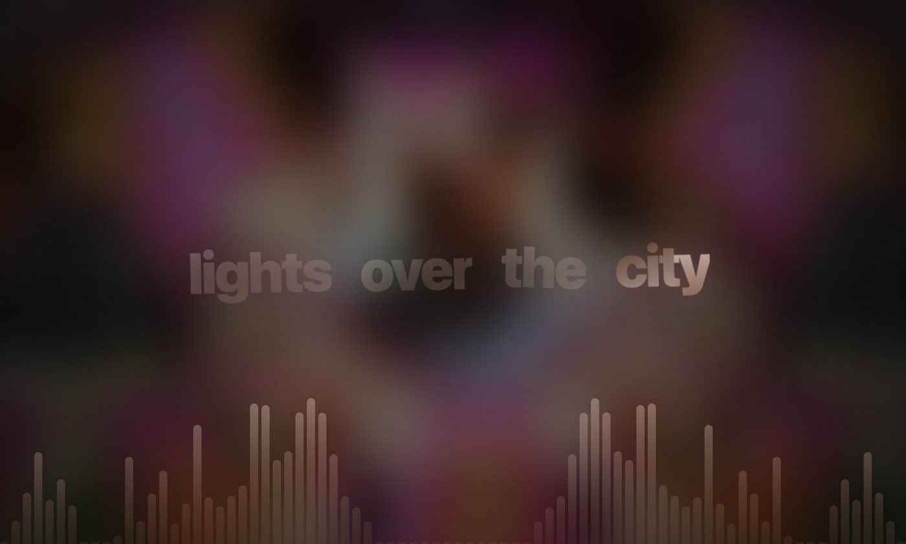
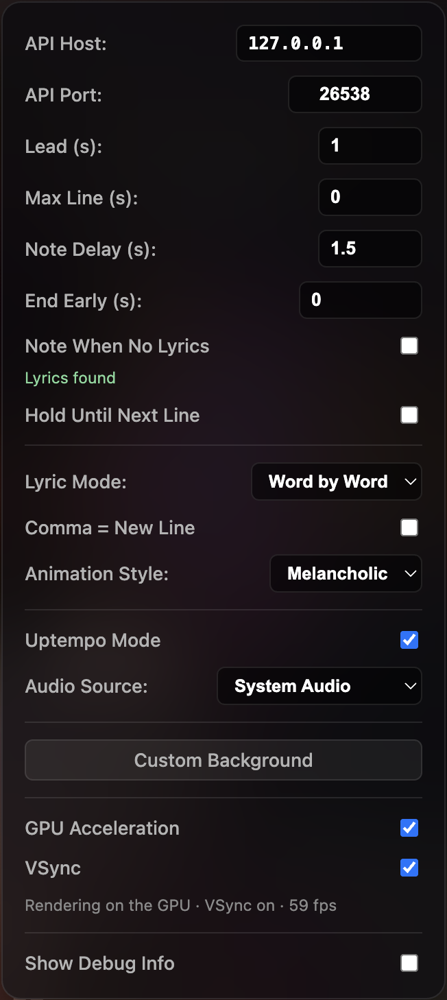

[](https://www.electron.org/)
[](https://www.kernel.org/)
[](https://adoptium.net/)
[](https://adoptium.net/)
[](https://archlinux.org/)
[](https://www.debian.org/)
[](https://getfedora.org/)
[](https://www.gentoo.org/)
[](https://www.opensuse.org/)

---

# Lyrics Player GUI

A desktop lyrics overlay for [Pear Music Desktop](https://github.com/pear-devs/pear-desktop). ~~It connects to Pear’s local API~~, shows synced lyrics in time with playback, and ~~falls back~~ fetch the lyrics form [LRCLIB](https://lrclib.net) ~~when Pear does not provide lyrics~~ Yeah this just never worked.

Built with **Electron** — a frameless-friendly window with a blurred album-art background and word-by-word line animations.

## Screenshots

| Main view | Controls |
| --- | --- |
|  |  |
| Synced lyrics over blurred cover art, with the Uptempo Mode visualizer | Connection, lyric timing, display, Uptempo Mode, GPU/VSync, debug |

## Features

- **Pear API integration** — WebSocket (`/api/v1/ws`) plus HTTP polling (`/api/v1/song`) for track metadata and playback position
- **Synced lyrics from LRCLIB** — Fetches synced LRC lyrics for the current track, with an adjustable lead time
- **Word-by-word or build-up animation** — Each line reveals one word at a time, spread evenly over the time until the next line, with a shine that keeps sweeping across the text
- **Two animation styles** — *Melancholic* (soft, slow) and *Vivid* (bright, bouncy), both colored from the album art
- **Line timing controls** — Cap how long a line stays up, cut time off the end of each line, hold text until the next line, or show a music note during instrumental breaks after a delay you choose
- **Uptempo Mode** — A cava-style audio visualizer between the background and the lyrics; the background, bars and lyrics bounce on kicks and snares from the music that is actually playing
- **System audio capture on every OS** — Windows (loopback), macOS 14.2+ (CoreAudio Tap) and Linux (PulseAudio or PipeWire), or any input device
- **GPU acceleration and VSync** — On by default, with toggles and a live frame-rate readout
- **Lyrics status** — The panel says whether lyrics were found for the current track; optionally show a music note instead of the "no lyrics" message
- **Local caching** — Lyrics and album art cached in `localStorage` for faster track changes
- **Custom background** — Optional image upload instead of the current track’s cover
- **Debug panel** — Optional raw JSON view of the Pear player state
- **Minimal UI** — Press **Space** to hide or show the controls panel

## Requirements

- Pear Music Desktop running with its API Server enabled (default port **26538**)
- To build from source: [Node.js](https://nodejs.org/) (LTS recommended)

## Download

Every push to `main` publishes a build on the [Releases page](https://github.com/qcom-toolbox/Lyrics-Player-GUI/releases).

| System | File |
| --- | --- |
| Windows (x64) | `PearLyrics-windows-x64.zip` — unzip and run `PearLyrics.exe` |
| macOS (Apple Silicon and Intel) | `PearLyrics-macos-universal.zip` — unzip and open `PearLyrics.app` |
| Debian, Ubuntu, Mint, Pop!_OS | `PearLyrics-<version>-linux-amd64.deb` or `-arm64.deb` |
| Fedora, openSUSE, RHEL | `PearLyrics-<version>-linux-x86_64.rpm` or `-aarch64.rpm` |
| Arch, Manjaro, EndeavourOS | `PearLyrics-<version>-linux-x64.pacman` or `-aarch64.pacman` |
| Any distro (x64) | `PearLyrics-<version>-linux-x86_64.AppImage` |
| Gentoo and anything else | `PearLyrics-<version>-linux-x64.tar.gz` or `-arm64.tar.gz` |

### Installing on Linux

```bash
# Debian / Ubuntu
sudo apt install ./PearLyrics-*-linux-amd64.deb

# Fedora / openSUSE
sudo dnf install ./PearLyrics-*-linux-x86_64.rpm      # or: sudo zypper install ./PearLyrics-*.rpm

# Arch
sudo pacman -U ./PearLyrics-*-linux-x64.pacman
```

The packages add **PearLyrics** to your app menu and install the `pearlyrics` command.

The **AppImage** and **tar.gz** builds are not installed system-wide, so Ubuntu 24.04 and newer block Electron's sandbox for them. Start them with `--no-sandbox`, or use the `.deb`:

```bash
chmod +x PearLyrics-*.AppImage
./PearLyrics-*.AppImage --no-sandbox
```

The AppImage also needs FUSE 2 (`sudo apt install libfuse2t64` on Ubuntu 24.04). There is no ARM64 AppImage, because its runtime needs a zlib file most systems don't have; use the ARM64 `.deb`, `.rpm`, `.pacman` or `.tar.gz` instead.

The app runs natively on Wayland and on X11.

### System audio on Linux

Uptempo Mode's **System Audio** source needs PulseAudio or PipeWire (with `pipewire-pulse`, the default on current Ubuntu, Fedora and Arch desktops) and the `pactl` command (package `pulseaudio-utils` on Debian/Ubuntu, `pulseaudio-utils` or `pipewire-pulseaudio` on Fedora, `libpulse` on Arch). Chromium refuses to record from the speakers' "monitor" directly, so while Uptempo Mode runs the app adds a virtual input called **PearLyrics-System-Audio** that mirrors your current output, and removes it when you quit.

## Build from source

```bash
git clone https://github.com/qcom-toolbox/Lyrics-Player-GUI.git
cd Lyrics-Player-GUI/src
npm install
npm start
```

## Usage

1. Start Pear Music Desktop and begin playback.
2. Start the API Server in Pear and set no verification (the app is not able to ask permission).
3. Start PearLyrics.
4. In the controls panel (top right), set **API Host** (usually `127.0.0.1`) and **API Port** (default `26538`).
5. Adjust **Lead (s)** if lyrics feel early or late relative to the audio.
6. Press **Space** to toggle the controls panel for a clean fullscreen lyrics view.

On macOS, the first time Uptempo Mode uses System Audio, allow PearLyrics under **System Settings → Privacy & Security → Screen & System Audio Recording**.

## Configuration

Settings are saved automatically.

| Setting | Description |
| --- | --- |
| API Host / API Port | Where Pear's API Server is (default `127.0.0.1:26538`) |
| Lead (s) | Timing offset in seconds; positive values show lyrics earlier |
| Max Line (s) | Longest a line stays on screen; its words speed up to fit. `0` = no limit |
| Note Delay (s) | How long the text stays after a line is done before the music note replaces it (default `1.5`) |
| End Early (s) | Cut this much off the end of every line (down to `0.001`); the text fades out before the next line. `0` = off |
| Note When No Lyrics | Show the music note instead of the "no lyrics" message. The line under it says whether lyrics were found |
| Hold Until Next Line | Keep a line's text up until the next line instead of showing the music note |
| Lyric Mode | *Word by Word* (one word at a time) or *Build-Up* (the line grows word by word) |
| Comma = New Line | A word ending in a comma ends the line; the rest plays as its own line |
| Animation Style | *Melancholic* or *Vivid* |
| Uptempo Mode | Audio visualizer and beat-reactive motion |
| Audio Source | *System Audio* (what your computer is playing), *Default Input* or a specific input device |
| Custom Background | Local image instead of the current track artwork |
| GPU Acceleration | Render on the graphics card; turn off if you see glitches or a black window (restarts the app) |
| VSync | Sync frames to the display; off uncaps the frame rate (restarts the app) |
| Show Debug Info | Live JSON payload from Pear |

## Packaging

```bash
npm run package:win     # Windows x64 → dist/
npm run package:mac     # macOS universal → dist/
npm run package:linux   # Linux .deb, .rpm, .pacman, .tar.gz (x64 + arm64) and x64 AppImage → dist-linux/
```

Building the `.rpm` needs `rpmbuild` and the `.pacman` needs `bsdtar` (`sudo apt install rpm libarchive-tools` on Ubuntu). The release workflow in `.github/workflows/release.yml` builds everything on each push to `main`.

## Project structure

```
src/
├── main.js           # Electron main process: window, GPU/VSync switches, system-audio capture
├── preload.js        # Bridge between the page and the main process
├── index.html        # UI shell
├── app.js            # Pear API, lyrics sync, LRCLIB, animations, Uptempo Mode
├── style.css         # Glassmorphism UI and lyric animations
├── icon.png          # App icon (Linux menu and window)
├── macos-info.plist  # macOS permission text for system-audio capture
└── package.json      # Scripts and Linux packaging config
```

## License

See [LICENSE](LICENSE).
